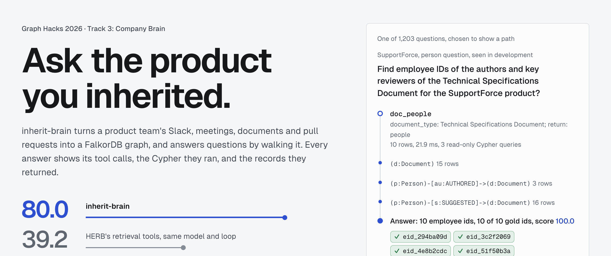
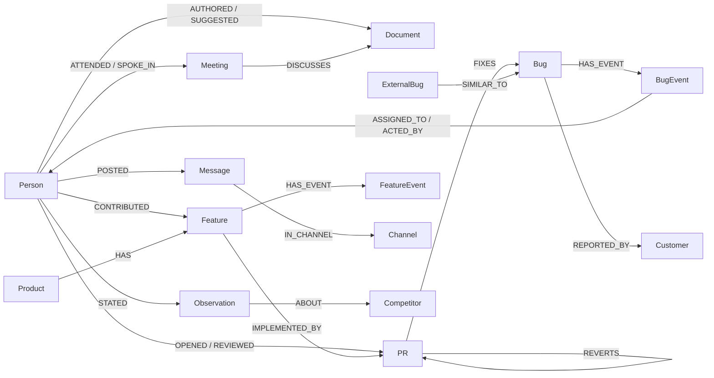
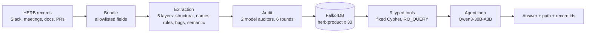

# inherit-brain

**Ask the product you inherited.**

inherit-brain answers a new maintainer's questions about a product's history: who wrote and reviewed a spec, who fixed the bugs customers reopened, which open work loses its owner when someone leaves. It turns a team's Slack channels, meeting transcripts, documents, pull requests and bug histories into one FalkorDB graph per product, and an agent answers by calling nine read-only graph tools. Each answer shows the tool calls, the Cypher they ran, and the records they returned.

Track 3: Company Brain, Graph Hacks 2026 (WeMakeDevs x FalkorDB).
[Demo site](https://zeyusuntt.github.io/inherit-brain/) · [Video](VIDEO_URL) · [Blog post](BLOG_URL) · [Results](results/RESULTS.md) · [Pre-registration](PREREG.md) · [Cypher](docs/CYPHER.md) · [MCP server](docs/MCP.md)

[](https://zeyusuntt.github.io/inherit-brain/)

On 1,203 held-out questions of Salesforce's [HERB](https://github.com/SalesforceAIResearch/HERB) benchmark (a simulated company with 30 products), with the plan's hash posted publicly before the run:

| Same model (Qwen3-30B-A3B-Instruct-2507) | Score (registered primary endpoint) | Median input tokens |
|---|---|---|
| **inherit-brain**, graph tools in the agent loop | **80.0** | 10,117 |
| HERB's own retrieval tools in the same loop, over the raw records | 39.2 | 46,451 |
| The whole product in one prompt (one call) | 26.0 | 125,947 |

Swap the graph tools for HERB's retrieval tools, with the same model, loop and limits, and the score drops 40.8 points (95% interval 35.7 to 46.2).

## What it does

One held-out question, answered during the scored run ([see it in the demo](https://zeyusuntt.github.io/inherit-brain/explore.html#q=SecurityForce/ans/21)):

> Find the employee IDs of engineers who authored maximum number of PRs in SecurityForce for bug fixes that are now reopened by customers.

inherit-brain made three tool calls (4 model calls, 19,339 input tokens, 9.4 s). The one that answered it is `bug_board`, which runs this Cypher as a read-only user:

```cypher
MATCH (b:Bug) WHERE b.reopened = true
  AND ($components IS NULL OR b.component IN $components)
  AND ($companies IS NULL OR any(x IN b.companies WHERE x IN $companies))
MATCH (pr:PR)-[fx:FIXES]->(b)
MATCH (p:Person)-[op:OPENED]->(pr)
MATCH (b)-[hs:HAS_EVENT]->(rs:BugEvent) WHERE rs.type = 'RESOLVED' AND pr.link IN rs.fix_pr_links
MATCH (b)-[:HAS_EVENT]->(ro:BugEvent) WHERE ro.type = 'REOPENED' AND ro.ts > rs.ts
RETURN p.eid, p.name, p.role, b.id, pr.link, op.src, fx.src + hs.src, [rs.id]
```

The query joins four kinds of record: the bug, the PR that fixed it, the PR's author, and the bug's history (resolved by that PR, then reopened). The tool then counts distinct fix PRs per author in Python and keeps everyone tied at the maximum. It returned one engineer, Julia Miller (`eid_c38fe0e7`), who wrote the fixes for two of the four reopened bugs, with the bug, PR and event records behind the count. That is HERB's gold answer (score 100). HERB's retrieval tools in the same loop named four other engineers (score 0), the whole-product prompt named 15 people with one of them right (12.5), and vector search named three wrong ones (0).

The [explorer](https://zeyusuntt.github.io/inherit-brain/explore.html) shows all 1,203 held-out questions this way: the question, HERB's gold answer, the answer and score of every arm that ran it, inherit-brain's tool calls with the Cypher they ran, and excerpts of the records it cited. Questions where inherit-brain lost are there too.

## Results

Each arm ran once on its registered products, in the order fixed in [PREREG.md](PREREG.md) (four arms on all 24 held-out products, four on registered subsets), committed at `bb5dcce` and posted before any held-out question was answered ([gist](https://gist.github.com/zeyusuntt/3012ee12697e7afade6d820e95d6bd67), [Wayback snapshot](https://web.archive.org/web/20261017025021/https://gist.github.com/zeyusuntt/3012ee12697e7afade6d820e95d6bd67), sha256 `d8f43632...602eadffd`). Intervals are a product-clustered paired bootstrap (10,000 replicates).

| | Comparison | Difference | 95% interval | Registered threshold | Result |
|---|---|---|---|---|---|
| H1 | inherit-brain minus HERB's tools in the same loop | +40.8 | 35.7 to 46.2 | lower bound above 0 | holds |
| H2 | inherit-brain minus the whole product in the prompt | +54.0 | 48.7 to 58.8 | lower bound above -3 | holds |
| H2 | its median input tokens as a share of that arm's | 8.0% | | at most 10% | holds |
| H3 | inherit-brain minus depth-1 card access, multi-hop questions | +90.2 | 84.5 to 95.8 | lower bound above 0 | holds, on 7 questions |
| H4 | correct refusals on unanswerable questions | 82.4% vs 13.8% | | at least as high | holds |

The primary endpoint covers the 478 questions with structured answers: the mean of three equally weighted groups (person, company, and artifact, which is PR and URL questions together), each scored with HERB's own set F1 on the answer ids, times 100. Token medians are over all 659 answerable questions. Content and unanswerable questions use HERB's judge prompts. The full tables, eight arms and every secondary contrast are in [results/RESULTS.md](results/RESULTS.md); per-question tables are in `results/tables/` and run receipts in `results/receipts/`. Total model spend for the whole project: 42.72 USD of a 50 USD cap.

Where it is weaker, from the same run:

- **Question strings seen in development.** 610 of the held-out questions share their wording (with the product name swapped) with a development question. The lead over HERB's tools is +57.9 on those and +20.1 (12.9 to 26.5) on the 593 never seen. The tools were designed on development questions; the lead on new wordings is about a third as large.
- **PR questions** are its weakest type (66.4).
- **Typed depth-1 access to the same entity cards** (arm A4) did worse than retrieval over those cards (-13.8), so typed access alone does not explain the result.
- **H3 rests on 7 questions**, one family. Read it as a small registered check.
- **The judge is the same open model**, so content scores are not comparable with the HERB paper's GPT-4o-judged numbers.

## Why a graph: the removal test

Rule 3 of the hackathon asks whether the product still works with FalkorDB taken out. We measured the closest version of that. Arm A0 is the same model in the same agent loop (12 tool calls, 60,000 input tokens per question) with HERB's own retrieval tools over the raw records in place of the graph tools. It scores 39.2 against 80.0, and it ran out of input budget on 44.5% of questions against 1.3%. This swaps the graph and its tools together: it shows the graph-backed tools carry the result, not that no other database could hold the same graph.

Three things the graph tools do that the retrieval tools did not:

1. **Joins across record types.** A bug lives in a ticket, its fix in a PR, its reporter in a customer directory, its reopening in an event history. The graph stores each link as an edge with the id of the record it came from (`src` is set on all 164,698 edges), so "who wrote the fixes for bugs customers reopened" is a traversal, not a search.
2. **Counting and ranking.** "Maximum number", "how many", "which customer reported the most" are aggregations over exact join results. Retrieval returns passages, and the model has to count what it happened to retrieve.
3. **Saying no.** When the traversal is empty, the tool says what it looked for. inherit-brain refused 80.5% of unanswerable questions explicitly, against 9.9% for the whole-product prompt.

## Graph data model

One graph per product, `herb:<product>`, 30 products, built from the extracted facts. Totals on FalkorDB 6.0.2: 56,708 nodes and 164,698 edges.



| Node label | Count | What it is |
|---|---|---|
| Message | 33,632 | A Slack message, with its text and channel |
| Person | 6,402 | An employee: id, name, role |
| FeatureEvent | 4,007 | A dated step in a feature's history (proposed, discussed, implemented, held, resumed, reverted) |
| PR | 3,562 | A pull request: link, title, state, approval, merge |
| BugEvent | 2,569 | A dated step in a bug's history (reported, assigned, resolved, reopened) |
| Feature | 1,757 | A product capability |
| ExternalBug | 900 | A similar bug in an outside project |
| Bug | 899 | A product bug, with component and reporting customers |
| Observation | 674 | A typed claim from a meeting or message (competitor fact, QA issue, demo) |
| Url | 606 | A shared link (demo, competitor page) |
| Customer | 521 | A customer company |
| Document | 400 | A product document, with type and release scope |
| Meeting | 321 | A meeting, with its transcript speakers |
| Channel | 302 | A Slack channel |
| Competitor | 126 | A competing product |
| Product | 30 | The product itself, the scope of every tool |

| Edge type | From, to | Count |
|---|---|---|
| IN_CHANNEL | Message, Channel | 33,632 |
| POSTED | Person, Message | 32,350 |
| COLLABORATED | Person, Person | 26,450 |
| MENTIONS | Message, Person | 12,947 |
| ATTENDED | Person, Meeting | 8,884 |
| HAS | Product, its Features, Competitors, Meetings, PRs, Documents, Bugs | 7,065 |
| HAS_EVENT | Bug, BugEvent; Feature, FeatureEvent | 6,576 |
| DISCUSSES | Message or Meeting, Document or Feature | 4,737 |
| REVIEWED | Person, PR | 4,609 |
| SHARED | Person, Url, Document or PR | 4,593 |
| SUGGESTED | Person, Document (a review suggestion) | 4,399 |
| SPOKE_IN | Person, Meeting | 3,693 |
| OPENED | Person, PR | 3,562 |
| ACTED_BY | BugEvent, Person | 2,569 |
| CONTRIBUTED | Person, Feature | 2,093 |
| ABOUT | Observation, Message, PR or Url, the thing it is about | 1,957 |
| REPORTED_BY | Bug or Observation, Customer or Person | 1,012 |
| ASSIGNED_TO | BugEvent, Person | 979 |
| SIMILAR_TO | ExternalBug, Bug | 899 |
| FIXES | PR, Bug | 488 |
| STATED | Person, Observation | 419 |
| AUTHORED | Person, Document | 400 |
| IMPLEMENTED_BY | Feature, PR | 296 |
| REVERTS | PR, PR | 89 |

The schema is defined in [src/inherit/graph/schema.py](src/inherit/graph/schema.py) and [src/inherit/ontology.py](src/inherit/ontology.py).

## The Cypher and graph algorithms it depends on

The agent never writes Cypher. It picks one of nine tools, and each tool runs fixed, parameterised Cypher through `GRAPH.RO_QUERY` as a read-only database user. [docs/CYPHER.md](docs/CYPHER.md) lists every query verbatim, with a recorded example for each tool the held-out run called.

| Tool | Question it answers | FalkorDB feature it leans on |
|---|---|---|
| `resolve_person` | Which employee is this name, id or meeting speaker? Namesakes are all returned, never guessed | directory match, SPOKE_IN for meeting speakers |
| `resolve_entity` | Which node is this title, alias, company or link? | exact match, then a full-text index fallback (`db.idx.fulltext.queryNodes`) |
| `doc_people` | Who wrote or reviewed a document type, with each person's evidence | AUTHORED and SUGGESTED edges, roles, release scope |
| `bug_board` | Bugs counted or ranked by company, person or status on a date | user-defined function `herb_v1.statusAt(events, $as_of)`, aggregation |
| `fix_trail` | Customer to its bugs to the fixing PRs to their authors | one path across four node labels |
| `feature_fate` | Features by fate (implemented, dropped), with dated history and PRs | event history per feature |
| `who_said` | Typed observations and demo links, by subject and release | release-scoped matching |
| `pr_board` | PRs by approval, revert reason, author or reviewer | REVERTS and FIXES joins, aggregation |
| `bridges` | People ranked by betweenness on the collaboration graph (no held-out question called it) | `algo.betweenness` on the COLLABORATED edges (native on 6.0, a Python fallback on 4.22) |
| `if_leaves` (what-if, not given to the agent) | If this person leaves, which open work has no owner left? | `GRAPH.COPY` under its own ACL user, delete in the copy, diff |

## Architecture



- **Extraction** ([src/inherit/extract/](src/inherit/extract/)). Three layers are plain code (structure, name resolution, rules); two use the model (bug histories, and semantic facts such as review suggestions and competitor claims). Every fact keeps the id of the record it came from.
- **Audit** ([src/eval/audit_extraction.py](src/eval/audit_extraction.py)). Before the held-out run, two model auditors (OpenAI Codex and a Claude agent) checked sampled facts against the raw records, with a third pass on disagreements. The extraction failed five rounds and passed the sixth. Between rounds the extraction rules and the audit rubrics changed, and the reviewer-recall endpoint was amended after round four; every round, including the failures, is in [PREREG.md section 12](PREREG.md).
- **Isolation.** One graph per product, and one read-only ACL user per product for the agent, so a question about one product cannot read another. The what-if runs as a separate user whose key patterns cover only its product graph and its own scratch copies (`GRAPH.COPY`, then delete in the copy).
- **Spend.** Every model call goes through one function ([src/inherit/llm.py](src/inherit/llm.py)) and a local metering proxy with a hard cap.
- **Tested on FalkorDB 4.22.1 and 6.0.2.** The tool tests run against both servers from `docker-compose.yml`. What differed between them, and the ACL and index behaviour we hit along the way (with minimal reproductions), is in [docs/falkor-versions.md](docs/falkor-versions.md) and [docs/sponsor-feedback.md](docs/sponsor-feedback.md).

## Setup

You need Docker and [uv](https://docs.astral.sh/uv/).

### Query the real graphs without a model key

The extracted facts, the embedding cache and the recorded held-out run are attached to the GitHub release, so this path makes no model call:

```bash
uv sync
docker compose up -d                 # FalkorDB 4.22.1 on 6379, 6.0.2 on 6380
make quickstart                      # download the release assets, load all 30 product graphs
uv run python -m inherit.ask --replay runs/eval/A5-held --slot SecurityForce/ans/21
```

The last command replays a recorded answer: it reruns each tool call of the scored run against your graph and prints the Cypher, the rows and the fresh timings next to the recorded ones.

To use the same tools from Claude Code, Claude Desktop or any MCP client, run the MCP server over one product graph ([docs/MCP.md](docs/MCP.md)):

```bash
uv run python -m inherit.mcp_server --product SecurityForce
```

### Rebuild everything from HERB

This path calls the model (Nebius AI Studio, `Qwen/Qwen3-30B-A3B-Instruct-2507` and `Qwen/Qwen3-Embedding-8B`). In `.env`, set `NEBIUS_API_KEY` and a spend cap `NEBIUS_BUDGET_USD` (the proxy refuses every call at the default of 0), then:

```bash
make download                        # HERB at a pinned commit, into data/raw (git-ignored)
make bundle                          # the allowlisted fields only
make proxy &                         # the metering proxy with the hard cap
for layer in structural names rules bugs semantic; do
  uv run python -m inherit.extract.run --layer $layer --products all
done
make load PRODUCTS=all
uv run python -m inherit.ask --product SecurityForce "Who reviewed the technical specifications document?"
```

### Tests

```bash
uv run pytest -q
```

1,805 tests at the last run, none of which calls a model; the graph and tool tests run against both FalkorDB servers.

## How it was evaluated

- **Benchmark.** HERB (Salesforce AI Research): 30 simulated products with their Slack, meetings, documents, PRs, employee and customer directories, and questions with gold answers. Six products were used for development; the other 24 (1,203 questions: 659 answerable, 544 with no answer in the records) were held out and answered once.
- **Arms.** Eight ways to answer with the same model and answer format: inherit-brain (A5); the HERB paper's tools in the same loop (A0); the whole product in one prompt (A1f); the paper's hybrid retrieval (A0v); depth-1 card access with and without a chain (A4, A4c); retrieval over the same cards (A0f); and FalkorDB's GraphRAG-SDK with its automatic ontology (A2). The descriptions and configuration hashes are in [PREREG.md](PREREG.md).
- **Freeze.** Code, prompts, tool descriptions, graphs (hashed per product) and the question split were frozen in `results/freeze/manifest.json` before the pre-registration; the launch preflight refused to run any arm whose hashes had drifted.
- **Grading.** HERB's set F1 on structured answer ids, HERB's judge prompts for content and unanswerable questions. Failed answers score 0 and stay in the denominator.

## What is real, and what is not

- The numbers come from one pre-registered run, graded by code against HERB's gold answers. Two analyses in RESULTS.md are post hoc and labelled so.
- HERB is synthetic: a simulated company written by a model. Validation on a real team's records remains to be done.
- The demo site replays the recorded run. It does not call a model, so you cannot type a new question there; the `ask` command and the MCP server do that locally.
- The what-if ("if this person leaves") is computed from recorded ownership and dependencies, not a prediction, and it was not part of the scored run.
- Extraction quality was audited by models, not people, on samples. PREREG section 12 has every round, including the failures.
- 46 of the 659 answers to answerable questions cite no record. On average 74.8% of the records an answer cites are among HERB's own citations for that question (recall 7.8%), which says the citations point at the right records, not that they prove the answer.
- `bridges` ranks by directed betweenness on collaboration edges stored once per pair, so its ranking depends on that orientation; no held-out question used it.

## Track 3 focus areas

| Focus area | Where it shows |
|---|---|
| Knowledge from docs, tickets and chats in one graph | 16 node labels from Slack, meetings, documents, PRs and bug histories, one graph per product |
| Who owns what and who knows what | `doc_people`, `bug_board`, `bridges` (betweenness on collaboration), the what-if |
| Tracing decisions back to the source | every edge stores its source record id; answers return the record ids their tools used, and on average 74.8% of those are among HERB's own citations |
| Keeping knowledge current | dated event histories for bugs and features, `herb_v1.statusAt` for the status on any date, current and previous release scopes |
| Answers with clear sources | the tool calls, Cypher and cited-record excerpts behind each of the 1,203 recorded answers, in the explorer |

## Built during the event

The first commit is 2026-10-16 05:01 UTC, after the event opened (2026-10-14 18:31 UTC). Everything in this repository was written during the event. Reused, as Rule 9 allows: the HERB dataset, HERB's scoring code (ported in [src/eval/grade.py](src/eval/grade.py)) and its retrieval baselines (ported in [src/baselines/](src/baselines/), with two upstream bugs fixed and listed in [paper_tools.py](src/baselines/paper_tools.py)), FalkorDB, GraphRAG-SDK and open-source Python libraries.

## AI assistance

I built inherit-brain with AI coding assistants, and every decision in it is mine:

- **The benchmark.** I chose HERB instead of writing my own questions: it is public, built by a third party (Salesforce AI Research), has gold answers and unanswerable questions, and comes with the paper's own agent as a baseline, so the result does not depend on questions I wrote for my own system.
- **The experiment.** I designed the comparison: the eight arms, the primary endpoint, the development and held-out split, the shared loop limits, the 50 USD spend cap, and the rules for what counts as a result, written down before the run.
- **The gates.** I set the design gates (the extraction audit thresholds, the freeze, the launch preflight, the pre-registration) and approved each one before work moved on, including the decision to keep the failed audit rounds on the record.
- **The release.** I decided when to post the pre-registration hash, when to run the held-out set, and what to publish.

Claude Code (Anthropic) and OpenAI Codex were my coding tools: Claude Code wrote most of the code and documents to my specifications, and Codex reviewed changes. In the extraction audit, a Codex agent and a Claude agent were also the two model auditors, under rubrics I approved; PREREG section 12 records their configuration. I can explain the graph model, every query and every design decision.

## Data and license

Questions, records and every excerpt shown on the demo site come from HERB by Salesforce AI Research, licensed CC BY-NC 4.0; they are used here for non-commercial research. Raw HERB data is not committed: `make download` fetches it. Our own code is MIT-licensed ([LICENSE](LICENSE)). Code ported from HERB (marked in each file) and all HERB-derived data, including the demo site's data and the release assets, stay under CC BY-NC 4.0; [NOTICE.md](NOTICE.md) lists them.

## Repository layout

```
src/inherit/        the product: extraction, graph loading, tools, agent, MCP server, ask CLI
src/baselines/      the comparison arms (HERB paper tools, long context, hybrid RAG, cards, GraphRAG-SDK)
src/eval/           questions, grading, statistics, pre-registration
tests/              unit and graph tests (both FalkorDB versions)
results/            frozen manifest, receipts, per-question tables, RESULTS.md
site/               the static demo site and the script that exports its data
docs/               CYPHER.md, MCP.md
```
